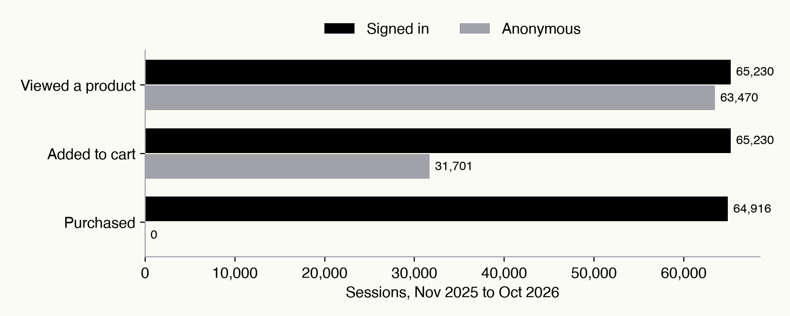
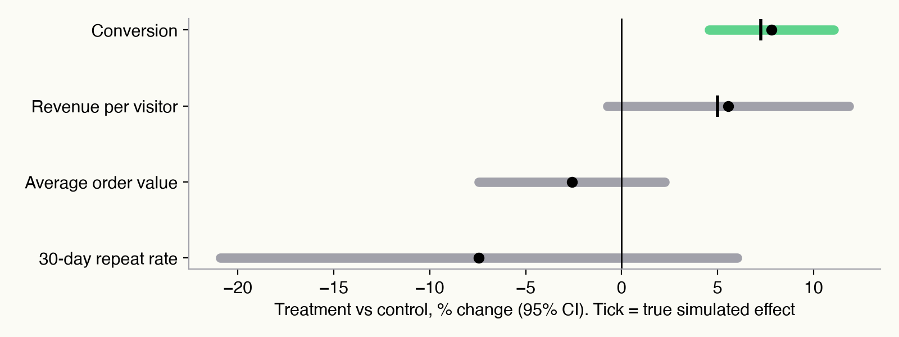

# Checkout funnel and a guest checkout test, built on BigQuery and dbt

A dbt project on Google BigQuery that models 2.3 million clickstream events from the public `thelook_ecommerce` dataset into a session funnel, a monthly KPI mart and a brand (merchant) mart, then evaluates a simulated A/B test of guest express checkout in Python.

Project page: https://abdullahmanini.github.io/checkout-funnel-dbt-bigquery/



## Summary

Recommendation: ship guest express checkout, keep a 10% holdout, and add an account prompt after a guest order before the next read.

Over the 12 months to October 31, 2026, anonymous shoppers started 63,470 sessions and added items to 31,701 carts. None of those carts became an order. Every one of the 64,916 purchases came from a signed-in session. Browser and traffic source barely move the funnel (conversion ranges from 49.8% to 50.8% across browsers), and product category moves it by a few points at most. The split that matters is whether the shopper was signed in.

That points to the sign-in step at checkout. I simulated an eight-week test (August 3 to September 27, 2026) where half of visitors could pay as a guest:

| Metric | Control | Treatment | Difference (95% CI) | p | True simulated effect |
|---|---|---|---|---|---|
| Conversion (visitor bought anything) | 45.25% | 48.78% | +3.53 pp (+2.06 to +5.00) | < 0.001 | +3.28 pp |
| Revenue per visitor | $36.01 | $38.01 | +5.5% (-0.8% to +11.8%) | 0.085 | +5.0% |
| Average order value (guardrail) | $86.42 | $84.17 | -2.6% (-7.4% to +2.2%) | 0.29 | |
| 30-day repeat rate of buyers (guardrail) | 9.02% | 8.35% | -0.67 pp (-1.89 to +0.54) | 0.28 | |

8,794 control and 8,789 treatment visitors (sample ratio check p = 0.97). The treatment arm placed 278 guest orders.

Conversion went up, and the estimate lands close to the effect I built into the simulation. Revenue per visitor probably went up too, but the eight-week window could only detect a change of about 9%, and the true effect is 5%. Average order value dipped because guest orders are single items with a 10% welcome code. The dip is not significant. The repeat rate also dipped, partly because guest buyers have no account, so a later order of theirs can't be linked back to them. That is a measurement gap, and the account prompt closes it.

Projected annual impact: +5.5% of trailing 12-month GMV ($3.27M), about +$181k a year, with a 95% interval of -$25k to +$388k. The interval includes zero, which is why the holdout stays.

## The funnel

`fct_checkout_funnel` has one row per session. Window functions (`LAG`, `LEAD`, `ROW_NUMBER`) order each session's events, find the product that was added to cart and time each step.

| Step | Sessions in | Sessions out | Lost | Drop-off |
|---|---|---|---|---|
| Product view to cart | 128,700 | 96,931 | 31,769 | 24.7% |
| Cart to purchase | 96,931 | 64,916 | 32,015 | 33.0% |

Cart to purchase loses the most shoppers, and 31,701 of the 32,015 lost carts belong to anonymous sessions. The other 314 are signed-in carts whose purchase had not landed by the October 31 cutoff. The median shopper adds to cart 124 seconds after the first product view and pays 5 minutes later.

Segment ranges over the same 12 months:

| Segment | Groups | Cart rate | Conversion |
|---|---|---|---|
| Browser | 5 | 74.7% to 75.5% | 49.8% to 50.8% |
| Traffic source | 5 | 74.9% to 75.6% | 50.3% to 50.9% |
| Product category | 26 | 72.2% to 77.1% | 48.9% to 56.9% |

The dataset has no device field, so I could not split mobile from desktop.

## The test



Design:

- Unit: visitor. Signed-in users are keyed on `user_id`, anonymous shoppers on `session_id` (thelook gives each anonymous visit its own session).
- Assignment: `FARM_FINGERPRINT` of a salted visitor key, split 50/50. Stable across sessions and reproducible.
- Treatment: anonymous carts in the treatment arm can pay as a guest. A fixed 12% of them (chosen by hash) do, at the carted product's list price minus a 10% welcome code.
- Primary metric: conversion. Secondary: revenue per visitor. Guardrails: average order value and 30-day repeat rate.
- Tests: two-proportion z-test for rates, Welch's t-test for revenue and order value, with Mann-Whitney U alongside. Holm correction for the traffic-source breakdown.

Mann-Whitney U on revenue per visitor gives p < 0.001, while Welch gives 0.085. Most visitors spend $0, so Mann-Whitney is mostly picking up the conversion change. Welch answers the dollar question, so the decision uses Welch.

By traffic source the lift is positive in all five groups, from +1.05 pp (organic, 879 visitors) to +5.13 pp (YouTube). After Holm correction only AdWords and Email are significant on their own. They are also the two largest groups, so I read this as a sample-size pattern and would not target by channel.

The simulation computes `would_recover` for both arms, so the true effect is known. The conversion estimate (+3.53 pp) is within 0.25 pp of the truth (+3.28 pp), and both true effects sit inside their confidence intervals.

## Pipeline

Lineage, from the public source to the marts:

- `stg_events` (view) feeds `int_session_steps`, which rolls each session up to one row.
- `stg_order_items` and `int_session_steps` feed `int_session_orders`, which matches purchase sessions to order lines.
- Those two and `stg_products` feed `fct_checkout_funnel`.
- `fct_checkout_funnel` feeds `mart_experiment_visitors`, `mart_monthly_kpis` and `mart_merchant_performance`.

Staging drops events after the `as_of` date (the public table has rows dated in the future; there were 1,377 when I ran it on November 16, 2026), parses product ids out of URIs, dedupes on event id and builds a visitor key.

thelook does not store a session id on orders. `int_session_orders` matches each purchase session to the order line from the same user, for a product viewed in that session, with the nearest timestamp. Every purchase session gets a match, and none is more than 10 minutes off.

`dbt build` runs 37 data tests: `unique`, `not_null`, `accepted_values` and `relationships` on keys and categorical columns, plus four custom ones:

- a purchase never comes before its cart add
- every purchase session has an order line
- guest orders never appear in the control arm
- session-to-order matches more than 10 minutes apart (warn)

All 37 pass. The log is in [`outputs/dbt_build.log`](outputs/dbt_build.log).

`mart_monthly_kpis` tracks sessions, GMV, conversion, AOV and the 30-day repeat rate of each month's first-time buyers. October 2026 shows no repeat rate because its buyers don't have 30 days of follow-up yet. `mart_merchant_performance` treats each of the 2,614 brands as a merchant and reports GMV, AOV, return rate, conversion and 30-day repeat. Brand-level repeat is close to zero in this data (12 brands above 0%), so store-level repeat is the more useful number.

After the first run I changed two definitions. Orders now exclude cancelled ones, so they match GMV when computing AOV. Repeat rates now leave out buyers without a full 30 days of follow-up. Neither change affected the recommendation.

## Run it yourself

You need a Google account. The BigQuery sandbox is free and needs no card.

```bash
gcloud auth login --update-adc
gcloud projects create <your-project-id>
gcloud services enable bigquery.googleapis.com --project <your-project-id>

python3 -m venv .venv && source .venv/bin/activate
pip install -r requirements.txt

export GCP_PROJECT=<your-project-id>
dbt build --profiles-dir .
python analysis/analysis.py
```

The build takes under a minute and stays well inside the sandbox's free monthly query allowance. `analysis.py` writes `outputs/results.json`, CSV snapshots of the marts and the two charts.

## What is real and what is simulated

thelook_ecommerce is a synthetic store that Google publishes for practice; it is not a real company's data. The funnel numbers, timings, GMV and brand metrics are what that dataset contains. Its generator makes some patterns look cleaner than real shoppers would, such as anonymous sessions never buying and segments that hardly differ.

The A/B test is simulated. Assignment, control outcomes and signed-in outcomes come from the data. The guest orders are invented by the rule above, and the 12% recovery rate and 10% discount are my assumptions. The test shows the method working against a known answer. It does not show how a real guest checkout would perform.

The dataset changes daily, so a rerun on a later date will give slightly different numbers. The dates in `dbt_project.yml` pin the windows.

## Layout

```
models/staging/        source definitions, stg_* views, schema tests
models/intermediate/   session roll-up and session-to-order matching
models/marts/          funnel fact, experiment, monthly and merchant marts
tests/                 custom data tests
analysis/analysis.py   funnel, A/B test, GMV projection, charts
outputs/               results.json, mart snapshots, charts, dbt log
index.html             project page
```
